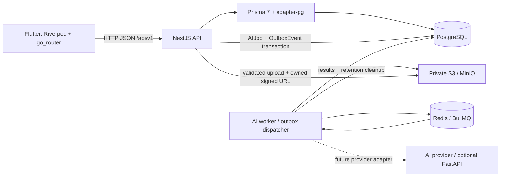

# Kiến trúc Wearly

## Audit và quyết định

Ngày 18/10/2026: frontend ban đầu ở `apps/storefront`, Flutter Web, Riverpod 3, go_router 17; chưa có backend hoặc .git. 174 test ban đầu đạt. Không có Android/iOS/desktop platform folders, vì dự án hiện chỉ tạo Web.

Người dùng cung cấp remote GitHub và cho phép cài công cụ. Đã khởi tạo Git, commit nguyên trạng trước di chuyển, chuyển 102 file nguồn/tài sản sang `frontend/` và kiểm tra SHA-256 từng file. Cache/build cũng di chuyển; pub get tạo lại tham chiếu. Các script tools và README_FRONTEND cập nhật đường dẫn; tài liệu lịch sử giữ nguyên.

| Khác biệt với đặc tả cũ | Quyết định triển khai |
|---|---|
| apps/storefront, apps/api, apps/worker | frontend + backend; worker là entrypoint riêng trong backend |
| /v1, /orders/checkout, /me | /api/v1, POST /orders, /users/me theo master prompt mới |
| Tiền JSON integer | PostgreSQL Decimal(14,0); JSON decimal string và currency VND, Dart chuyển số nguyên có kiểm tra |
| Prisma config đề xuất prisma7.config.ts | Dùng prisma.config.ts được CLI tự nhận; client/CLI/adapter 7.10.1 |
| Giữ tồn cho thanh toán online | Foundation COD trừ ngay khi tạo đơn, hoàn đúng một lần khi hủy PENDING; reservation/expiry cho online để giai đoạn sau |
| Web cookie session | API bearer JWT; Flutter catalog public không cần token, session store mới chỉ nằm trong RAM; persistent Web auth/cookie/CSRF cần giai đoạn tích hợp auth |
| AI, embeddings, pgvector, real payment | Không bật provider thật; interfaces/schema/worker có sẵn, các tính năng này chưa hoàn thiện |
| Các module danh mục, thương hiệu, địa chỉ riêng | Gộp controller/service theo Catalog và Users để tránh module rỗng |
| Frontend design | Giữ palette/font/layout hiện có; chỉ thêm tầng network và hỗ trợ URL ảnh trong component dùng chung |

Prisma 7 theo [hướng dẫn nâng cấp chính thức](https://www.prisma.io/docs/guides/upgrade-prisma-orm/v7) và [quy tắc tên config](https://www.prisma.io/docs/orm/v7/reference/prisma-config-reference). Generated client chọn CJS rõ ràng cho NestJS 11; Node 24 chạy toolchain. Không nâng lên Prisma 8 RC.

## Hệ thống

Bắt buộc: Flutter, API, PostgreSQL. Redis bắt buộc cho worker/outbox; readiness báo lỗi khi Redis chưa hoạt động. Storage chỉ cần khi tích hợp ảnh, MinIO có profile `storage`. AI provider/FastAPI, pgvector, CDN và thanh toán online là tùy chọn chưa bật.

## Modules

```mermaid
flowchart TD
  App["AppModule"] --> Config["ConfigModule: validated env"]
  App --> Security["AuthGuard + ThrottlerGuard + validation + filter"]
  App --> Auth["AuthModule"]
  App --> Users["UsersModule: profile + addresses + style"]
  App --> Catalog["ProductsModule: products + categories + brands"]
  App --> Cart["CartModule"]
  App --> Orders["OrdersModule"]
  App --> Wishlist["WishlistModule"]
  App --> Reviews["ReviewsModule: verified purchase + own history"]
  App --> Admin["AdminModule: guarded management"]
  App --> Health["HealthModule"]
  App --> AI["AiModule"]
  App --> Uploads["UploadsModule: consent + quotas + ownership"]
  Auth & Users & Catalog & Cart & Orders & Wishlist & Reviews & Admin & Health & AI & Uploads --> Prisma["PrismaModule / PrismaService"]
  AI --> Adapter["TryOnProvider: Disabled by default"]
  AI --> Storage["StorageService"]
  Uploads --> Storage
  Worker["WorkerModule: separate process"] --> Prisma
  Worker --> Processor["AiProcessor + outbox dispatcher"]
  Processor --> Adapter
  Processor --> Storage
  Processor --> Queue["BullMQ"]
  Worker --> Retention["RetentionWorker / ImageLifecycleService"]
  Retention --> Prisma
  Retention --> Storage
```

Auth chịu trách nhiệm Argon2id, JWT, session hash, rotation/replay/logout. Users quản lý hồ sơ/địa chỉ theo owner, receipt chống tạo địa chỉ trùng khi retry và hồ sơ phong cách có version. Products trả catalog active, filters cùng SKU và facets. Cart lấy giá/tồn hiện hành. Orders tính tiền, snapshot, transaction và hoàn kho. Wishlist lưu yêu thích theo tài khoản; Reviews kiểm tra đơn đã giao, quyền sửa/xóa và lịch sử đánh giá cá nhân. Admin có guard RBAC trên toàn controller. Health tách liveness/readiness. AI kiểm tra provider, consent và ownership; outbox tránh mất enqueue khi Redis lỗi.

## Luồng dữ liệu và ranh giới

Flutter screen → Riverpod → ProductRepository → ApiClient HTTP → controller/DTO/guard → service → PrismaService → PostgreSQL. Screen không truy cập database. Loading/error dùng FutureProvider hiện có; adapter chuyển JSON và lỗi tiếng Việt.

API mặc định không log body, token, password, query hoặc signed URL; chỉ requestId/method/status/duration. Exception filter không trả stack hoặc lỗi DB nội bộ. CORS allowlist không bật credentials; Swagger bị tắt trong production.

Throttling hiện theo bộ nhớ một API process. Cần Redis-backed throttling, TLS, observability, backup/restore, chính sách metadata dài hạn và security review trước production.

AI provider mặc định Disabled: POST jobs trả503 đúng nghĩa. Upload API có validation bytes/resolution, metadata stripping, consent, ownership, quota và cleanup retry; đã kiểm thử với PostgreSQL/MinIO thật. Worker khóa theo ảnh khi công bố kết quả, đồng bộ với xóa. Chưa có adapter AI thật hoặc tích hợp Flutter Try-On remote. Xem [private-images.md](private-images.md).
