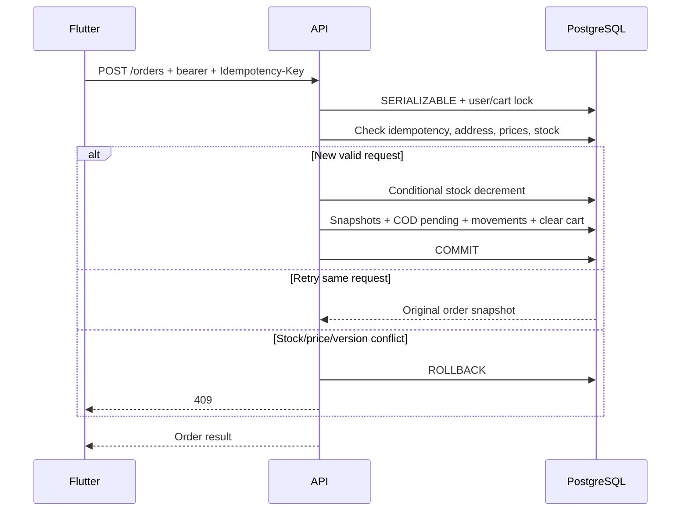

# Báo cáo nền tảng backend Wearly — 18/10/2026

**Cập nhật Flutter API shopping:** Đã nối đăng ký/đăng nhập/refresh/logout, hồ sơ, CRUD địa chỉ, giỏ hàng, COD, lịch sử phân trang/chi tiết và hủy đơn. UI Flutter được giữ, remote mode dùng `tools/frontend.ps1 api`. Kiểm thử PostgreSQL thật và Chrome bao gồm đăng nhập lại để khôi phục dữ liệu, hủy đơn trả kho và resize375/1440px. Không thay backend/schema trong đợt này. Các số liệu foundation bên dưới là lịch sử; kết quả mới tại [progress.md](progress.md).

## A. Cấu trúc thực tế

```text
D:/Fashion Shop/
├── frontend/
│   ├── assets/                  ảnh và font gốc
│   ├── lib/
│   │   ├── app/                 Riverpod/go_router giữ nguyên
│   │   ├── core/network/        ApiClient, SessionTokens
│   │   ├── core/design/         tokens và motion gốc
│   │   ├── core/widgets/        FashionImage hỗ trợ URL
│   │   ├── data/                mock + remote_catalog.dart
│   │   ├── domain/              contracts gốc
│   │   ├── features/            các screen gốc
│   │   └── main.dart
│   ├── test/                    regression + remote + live API
│   ├── web/
│   └── pubspec.yaml, pubspec.lock, README.md
├── backend/
│   ├── prisma/
│   │   ├── schema.prisma, seed.ts
│   │   └── migrations/
│   │       ├── 20261018000000_init/migration.sql
│   │       ├── 20261018000100_constraints/migration.sql
│   │       ├── 20261018000200_private_images/migration.sql
│   │       ├── 20261018000300_image_cleanup_retry/migration.sql
│   │       └── migration_lock.toml
│   ├── src/
│   │   ├── config/
│   │   ├── common/              guards, decorators, filters, money, transactions
│   │   ├── database/            PrismaModule, PrismaService
│   │   ├── modules/
│   │   │   ├── auth/, users/, products/
│   │   │   ├── cart/, orders/, admin/
│   │   │   └── health/, ai/, uploads/
│   │   ├── integrations/        payments, ai-providers, storage
│   │   ├── queues/              AI queue options
│   │   ├── worker/              main, module, processor
│   │   ├── generated/prisma/    generated, ignored
│   │   └── main.ts, bootstrap.ts, app.module.ts
│   ├── test/                    Jest unit và PostgreSQL E2E
│   ├── prisma.config.ts
│   ├── package.json, package-lock.json
│   ├── Dockerfile, Dockerfile.worker, .dockerignore
│   └── .env.example, README.md, tsconfig.json, nest-cli.json
├── docs/
│   ├── architecture.md, database.md, api.md, setup.md
│   ├── migration-plan.md, progress.md, backend-ledger.md
│   ├── backend-report.md
│   └── diagrams/                system, modules, database-erd, order-flow .mmd
├── design-system/               tài liệu thiết kế gốc
├── tools/                       script frontend + backend + môi trường/test
├── .tools/                      SDK/runtime/database tạm, ignored
├── docker-compose.yml, .env.example, .gitignore, .gitattributes
└── README.md, README_FRONTEND.md, đặc tả gốc
```

Thư mục apps/ cũ hiện trống sau move. Không dựng lại UI; 102 file nguồn/tài sản được kiểm tra hash trước/sau move. Git baseline commit giữ nguyên vị trí cũ để Git nhận rename.

## B. Sơ đồ

- [Hệ thống và module NestJS](architecture.md)
- [ERD và database rules](database.md)
- Mermaid sources: [system](diagrams/system.mmd), [modules](diagrams/modules.mmd), [ERD](diagrams/database-erd.mmd), [order flow](diagrams/order-flow.mmd)



## C. File quan trọng

Di chuyển toàn bộ apps/storefront → frontend; sửa đường dẫn tools/frontend.ps1, serve.cjs, browser-flow/refinement/account-journeys và README_FRONTEND.

Frontend bổ sung core/network/api_client.dart, session_tokens.dart, data/remote_catalog.dart, remote/live catalog tests; sửa app/config.dart, providers.dart, primitives.dart và dependency http. Không thay controller, screen, font, color hoặc bố cục.

Backend gồm22 model,4 migrations,seed,PrismaService,10 feature modules, common validation/security/errors, provider interfaces và worker riêng. Docker Compose, env generator, backend/test PowerShell helpers và toàn bộ tài liệu được bổ sung.

## D. Database

22 model có PK/FK/unique/index, Decimal VND, snapshot, enum và CHECK constraints. Đã cài PostgreSQL **17.11** trực tiếp trên Windows, tạo `wearly`/`wearly_test` UTF8 và áp dụng bốn migrations. Seed có32 sản phẩm/256SKU; migration ảnh chỉ bổ sung cột/index, không reset dữ liệu. PostgreSQL18.4 portable không còn được dùng. Compose PostgreSQL17.11 đã chạy Healthy sau lần restart lúc20:39; DB container riêng ở5433, chưa migrate/seed, không thay database native5432.

## E. API

Auth, users/addresses, public catalog, cart, orders, các endpoint admin được liệt kê tại [api.md](api.md) có implementation database thật. Swagger http://localhost:3000/api/docs đã trả OpenAPI khi smoke/E2E.

Trong lần kiểm thử backend trước restart, GET health/readiness trả200 và xác nhận PostgreSQL/Memurai; AI job create trả503 vì provider Disabled. Worker/outbox đã kiểm thử trên PostgreSQL + Memurai thật; AI và storage trong worker tests là doubles để điều khiển race. Upload E2E riêng dùng MinIO thật: upload/owned read/delete/retention/quota đã có. Chưa có real Try-On. Sau Windows restart, chạy lại API/worker theo setup.md.

## F. Công cụ và cách chạy

| Công cụ | Kết quả |
|---|---|
| Node | 24.22.0 LTS portable, thêm user PATH |
| Flutter/Dart | Flutter3.47.7 / Dart3.13.5 portable, thêm user PATH |
| Git | Git for Windows2.55.0.5 cài xong; origin pqchien1905/WEARLY |
| WSL | 3.0.3 cài xong |
| Docker Desktop | 4.95.0/Engine29.8.2 Running; hello-world exit0 |
| Windows virtualization features | vmcompute/HNS đã phục hồi và Running; WSL2 hoạt động, CBS RebootPending=false sau restart20:39 |
| PostgreSQL | 17.11 Windows Service tự khởi động, localhost5432, psql và pgAdmin đã cài |
| Redis local | Memurai Developer4.1.2, Redis API7.2.5, localhost6379, AOF/noeviction |
| MinIO native | RELEASE.2025-09-07T16-13-09Z, loopback9000/9001, private buckets; chỉ phát triển local |
| Docker PostgreSQL/Redis | Healthy, host5433/6380; query PostgreSQL17.11 và Redis PONG đạt |
| Docker API/worker/MinIO | Chưa build/chạy; cấu hình Compose có |
| Prisma/Studio, NestJS, Jest, ESLint/Prettier | Cài local trong backend, có npm scripts |

Luồng native chạy theo [setup.md](setup.md): kiểm tra service Windows → MinIO → generate/deploy/seed → API/worker → Flutter. pgAdmin đã có kết nối WEARLY; credential nằm trong file local bị Git ignore. Docker publish5433/6380 tránh tranh cổng native5432/6379. Windows đã restart sau khi người dùng xác nhận lưu công việc. Memurai Developer không dùng production và tự dừng sau10 ngày.

## G. Kiểm thử thực tế

| Lệnh/kiểm tra | Kết quả |
|---|---|
| Baseline flutter test | 174 đạt |
| Prisma validate + generate | Đạt,7.10.1 |
| Prisma deploy | 4 migrations đạt trên native main/test |
| Seed2 lần | Đạt |
| Backend build | Đạt |
| Backend lint | Đạt |
| Jest unit | 11 đạt, gồm image validation, upload resumption và URL signing endpoint |
| PostgreSQL E2E | 10 commerce đạt trên PostgreSQL17.11 |
| Worker E2E | 10 đạt trên PostgreSQL17.11 + Memurai |
| Upload E2E | 7 đạt trên PostgreSQL17.11 + MinIO; tổng27 E2E |
| Worker retries/privacy | Retry3 lần, sanitized Redis errors, outbox replay không tạo lại result, nguồn ảnh bị xóa/expired không xuất result |
| AI ownership/consent | Chặn ảnh/kết quả của user khác; consent thiếu hoặc false trả400 |
| Last SKU concurrency | Một201, một409; tồn0 |
| Concurrent duplicate checkout | Cùng order ID; chỉ1 đơn |
| Concurrent cancellation | Hoàn kho đúng1 lần |
| Refresh replay/logout/ownership/role injection | Đạt |
| Flutter remote adapter | 6 đạt |
| Flutter full suite | 180 đạt; live test skip khi không cấp URL |
| Flutter live catalog test có URL | 1 đạt với API/DB thật |
| Flutter analyze | Không issues |
| Flutter build web --release | Đạt |
| docker compose config --quiet | Đạt |
| docker run --rm hello-world | Đạt sau restart; pull và chạy Linux container thành công |
| docker compose up -d --wait postgres redis | Đạt; hai container Healthy, query PostgreSQL và Redis PONG thành công |
| Native service/pgAdmin | PostgreSQL và Memurai Running; pgAdmin driver đọc được32 sản phẩm |
| API readiness | 200, database=true và redis=true |
| Compiled API smoke | Cổng loopback tạm: readiness/catalog200, upload401 khi chưa auth, Swagger có upload/delete; tự đóng app |
| npm audit --omit=dev | 0 vulnerability sau override js-yaml5.4.1 |

Đã gặp lỗi và xử lý: PostgreSQL portable lấy WIN1252 theo Windows locale → tạo DB UTF8 riêng; không xóa DB cũ. Tổng Decimal vượt giới hạn trả500 → thêm validation400 trước stock mutation, E2E chứng minh. Flutter lint và ESLint CJS config đã sửa. pg8 có deprecation warning về Prisma query scheduling; chưa nâng pg9. Flutter build có thông tin Wasm dry-run; bản JavaScript release build thành công.

Lần tiếp tục này phát hiện lỗi provider exception có thể được BullMQ lưu nguyên văn trong Redis; test đã tái hiện lỗi rồi xác nhận bản sửa chỉ lưu mã an toàn. Test namespace độc lập tránh xử lý nhầm hàng đợi phát triển.

Review upload phát hiện ba race/cleanup defects và một validation discrepancy; cả bốn có regression RED→GREEN. Final11 unit/27 E2E, build/lint và compiled smoke đạt. Flutter live catalog1 đạt trước restart, frontend source không đổi. Reload API/worker từng bị execution policy chặn; các tiến trình cũ đã kết thúc khi Windows restart. Source/dist/migrations đã cập nhật; chạy lại API/worker theo setup.md. Lần sửa Docker chỉ xác minh Engine, hello-world và Compose PostgreSQL/Redis.

Nền tảng local đã đáp ứng các tiêu chí chạy API/database/Prisma/auth/catalog/cart/orders, kết nối catalog Flutter, worker và private upload lifecycle trong phạm vi kiểm thử. Docker Engine và container PostgreSQL/Redis đã được xác minh. Chưa kiểm chứng: container build/runtime API/worker/MinIO, Android/iOS/desktop, provider/payment thật. Chưa tuyên bố production-ready.

## H. Việc tiếp theo

1. Docker đã phục hồi; tiếp theo kiểm chứng container build/runtime API/worker/MinIO và migrations/seed trên DB container riêng. Worker native đã được kiểm thử.
2. Luồng Flutter auth → địa chỉ → cart → COD/orders đã nối. Tiếp tục remote admin, wishlist/style/reviews và khôi phục mật khẩu; xem [migration-plan.md](migration-plan.md).
3. Nối private upload hiện có vào Flutter, triển khai TryOnProvider thật, bổ sung cancel riêng job và kiểm thử provider thực.
4. Payment gateway/webhook và reservation expiry; COD settlement; không tự đánh dấu đã thanh toán.
5. Hoàn thiện admin audit/concurrency, wishlist/reviews/promotions/style profile, CI, backup/restore và hardening production.
