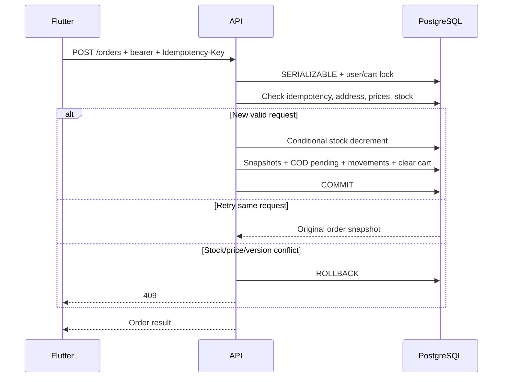

# Báo cáo nền tảng backend Wearly — 18/10/2026

## A. Cấu trúc thực tế

```text
D:/Fashion Shop/
├── frontend/
│   ├── assets/                  ảnh và font gốc
│   ├── lib/
│   │   ├── app/                 Riverpod/go_router giữ nguyên
│   │   ├── core/network/        ApiClient, SessionTokens
│   │   ├── core/design/         tokens và motion gốc
│   │   ├── core/widgets/        FashionImage hỗ trợ URL
│   │   ├── data/                mock + remote_catalog.dart
│   │   ├── domain/              contracts gốc
│   │   ├── features/            các screen gốc
│   │   └── main.dart
│   ├── test/                    regression + remote + live API
│   ├── web/
│   └── pubspec.yaml, pubspec.lock, README.md
├── backend/
│   ├── prisma/
│   │   ├── schema.prisma, seed.ts
│   │   └── migrations/
│   │       ├── 20261018000000_init/migration.sql
│   │       ├── 20261018000100_constraints/migration.sql
│   │       └── migration_lock.toml
│   ├── src/
│   │   ├── config/
│   │   ├── common/              guards, decorators, filters, money, transactions
│   │   ├── database/            PrismaModule, PrismaService
│   │   ├── modules/
│   │   │   ├── auth/, users/, products/
│   │   │   ├── cart/, orders/, admin/
│   │   │   └── health/, ai/
│   │   ├── integrations/        payments, ai-providers, storage
│   │   ├── queues/              AI queue options
│   │   ├── worker/              main, module, processor
│   │   ├── generated/prisma/    generated, ignored
│   │   └── main.ts, bootstrap.ts, app.module.ts
│   ├── test/                    Jest unit và PostgreSQL E2E
│   ├── prisma.config.ts
│   ├── package.json, package-lock.json
│   ├── Dockerfile, Dockerfile.worker, .dockerignore
│   └── .env.example, README.md, tsconfig.json, nest-cli.json
├── docs/
│   ├── architecture.md, database.md, api.md, setup.md
│   ├── migration-plan.md, progress.md, backend-ledger.md
│   ├── backend-report.md
│   └── diagrams/                system, modules, database-erd, order-flow .mmd
├── design-system/               tài liệu thiết kế gốc
├── tools/                       script frontend + backend + môi trường/test
├── .tools/                      SDK/runtime/database tạm, ignored
├── docker-compose.yml, .env.example, .gitignore, .gitattributes
└── README.md, README_FRONTEND.md, đặc tả gốc
```

Thư mục apps/ cũ hiện trống sau move. Không dựng lại UI; 102 file nguồn/tài sản được kiểm tra hash trước/sau move. Git baseline commit giữ nguyên vị trí cũ để Git nhận rename.

## B. Sơ đồ

- [Hệ thống và module NestJS](architecture.md)
- [ERD và database rules](database.md)
- Mermaid sources: [system](diagrams/system.mmd), [modules](diagrams/modules.mmd), [ERD](diagrams/database-erd.mmd), [order flow](diagrams/order-flow.mmd)



## C. File quan trọng

Di chuyển toàn bộ apps/storefront → frontend; sửa đường dẫn tools/frontend.ps1, serve.cjs, browser-flow/refinement/account-journeys và README_FRONTEND.

Frontend bổ sung core/network/api_client.dart, session_tokens.dart, data/remote_catalog.dart, remote/live catalog tests; sửa app/config.dart, providers.dart, primitives.dart và dependency http. Không thay controller, screen, font, color hoặc bố cục.

Backend mới gồm22 model,2 migration,seed,PrismaService,8 feature modules, common validation/security/errors, provider interfaces và worker riêng. Docker Compose, env generator, backend/test PowerShell helpers và toàn bộ tài liệu được bổ sung.

## D. Database

22 model có PK/FK/unique/index, Decimal VND, snapshot, enum và CHECK constraints. PostgreSQL thật18.4 tạm đã nhận2 migrations trong2 database UTF8 mới. Seed chạy2 lần,32 sản phẩm/256SKU, không nhân bản/đặt lại giá/tồn. Compose target PostgreSQL17 còn chờ Docker Engine sau reboot.

## E. API

Auth, users/addresses, public catalog, cart, orders, các endpoint admin được liệt kê tại [api.md](api.md) có implementation database thật. Swagger http://localhost:3000/api/docs đã trả OpenAPI khi smoke/E2E.

GET health chạy; readiness cố ý báo503 nếu thiếu Redis. AI job routes có implementation ownership/config checks nhưng create hiện trả503 vì provider Disabled. Chưa có real Try-On hoặc upload.

## F. Công cụ và cách chạy

| Công cụ | Kết quả |
|---|---|
| Node | 24.22.0 LTS portable, thêm user PATH |
| Flutter/Dart | Flutter3.47.7 / Dart3.13.5 portable, thêm user PATH |
| Git | Git for Windows2.55.0.5 cài xong; origin pqchien1905/WEARLY |
| WSL | 3.0.3 cài xong |
| Docker Desktop | 4.95.0 cài xong; CLI29.8.2, Compose5.6.0 |
| Windows virtualization features | Enabled nhưng RestartNeeded=true |
| PostgreSQL | Runtime18.4 tạm chạy55432 để test; Compose17 sau reboot |
| Redis/MinIO | Cấu hình Compose có; chưa chạy được trước reboot |
| Prisma/Studio, NestJS, Jest, ESLint/Prettier | Cài local trong backend, có npm scripts |

Không tự restart Windows. Sau reboot, theo thứ tự [setup.md](setup.md): docker compose up → npm ci → generate → deploy → seed → API/worker → Flutter. PostgreSQL/Redis dùng Docker, không yêu cầu cài Windows services.

## G. Kiểm thử thực tế

| Lệnh/kiểm tra | Kết quả |
|---|---|
| Baseline flutter test | 174 đạt |
| Prisma validate + generate | Đạt,7.10.1 |
| Prisma deploy DB mới | 2 migrations đạt |
| Seed2 lần | Đạt |
| Backend build | Đạt |
| Backend lint | Đạt |
| Jest unit | 4 đạt |
| PostgreSQL E2E | 10 đạt, gồm overflow regression |
| Last SKU concurrency | Một201, một409; tồn0 |
| Concurrent duplicate checkout | Cùng order ID; chỉ1 đơn |
| Concurrent cancellation | Hoàn kho đúng1 lần |
| Refresh replay/logout/ownership/role injection | Đạt |
| Flutter remote adapter | 6 đạt |
| Flutter full suite | 180 đạt; live test skip khi không cấp URL |
| Flutter live catalog test có URL | 1 đạt với API/DB thật |
| Flutter analyze | Không issues |
| Flutter build web --release | Đạt |
| docker compose config --quiet | Đạt |
| docker compose up postgres redis | Thất bại vì VMP chờ restart |
| npm audit --omit=dev | 0 vulnerability sau override js-yaml5.4.1 |

Đã gặp lỗi và xử lý: PostgreSQL portable lấy WIN1252 theo Windows locale → tạo DB UTF8 riêng; không xóa DB cũ. Tổng Decimal vượt giới hạn trả500 → thêm validation400 trước stock mutation, E2E chứng minh. Flutter lint và ESLint CJS config đã sửa. pg8 có deprecation warning về Prisma query scheduling; chưa nâng pg9. Flutter build có thông tin Wasm dry-run; bản JavaScript release build thành công.

Chưa kiểm chứng: container build/runtime PostgreSQL17/Redis, queue/outbox thực tế với Redis, MinIO upload lifecycle, Android/iOS/desktop, provider/payment thật. Không đánh dấu toàn bộ tiêu chí master prompt hoàn tất trước những kiểm tra còn thiếu.

## H. Việc tiếp theo

1. Khởi động lại Windows, chạy Docker/PostgreSQL17/Redis và lặp migration/E2E; xác minh worker enqueue/retry với Redis.
2. Nối Flutter auth → địa chỉ → cart → orders cùng cache async và idempotency, bảo toàn UI.
3. Private uploads với byte/MIME/resolution checks, consent, quota, delete/retention; sau đó chọn và triển khai TryOnProvider thật.
4. Payment gateway/webhook và reservation expiry; COD settlement; không tự đánh dấu đã thanh toán.
5. Hoàn thiện admin audit/concurrency, wishlist/reviews/promotions/style profile, CI, backup/restore và hardening production.
