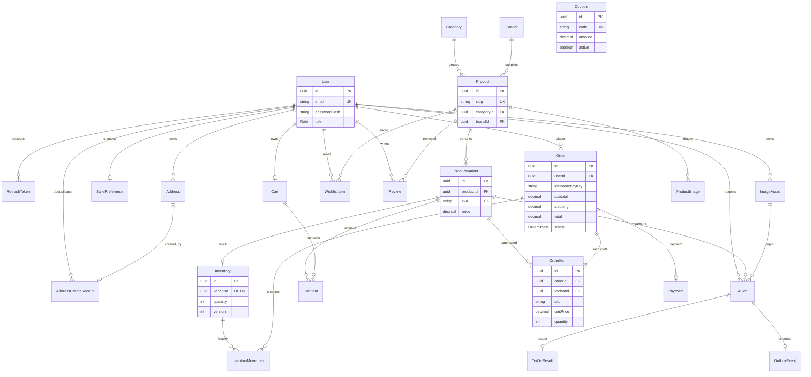

# PostgreSQL và Prisma

CLI, client, PostgreSQL adapter đều khóa **7.10.1**. Schema ở `backend/prisma/schema.prisma`; client generate vào `backend/src/generated/prisma`; PrismaService quản lý pool/connection/shutdown.

## Các bảng

| Nhóm | Bảng | Quy tắc |
|---|---|---|
| Tài khoản | User, RefreshToken, Address, AddressCreateReceipt, StylePreference | UUID PK; receipt có PK(userId,key); email unique lowercase ở DTO; token chỉ SHA-256; một địa chỉ mặc định/user; StylePreference dùng userId PK/FK, budget Decimal, version chống ghi đè |
| Catalog | Category, Brand, Product, ProductVariant, ProductImage | slug/SKU unique; unique (productId,size,color); ảnh unique (productId,position) |
| Kho | Inventory, InventoryMovement | 1 inventory/SKU; quantity>=0; version tăng sau mutation; movement delta/reason/order |
| Giỏ | Cart, CartItem | 1 cart/user; unique (cartId,variantId); quantity 1..99 |
| Đơn | Order, OrderItem, Payment | unique (userId,idempotencyKey); immutable item/address snapshot; 1 payment/order |
| Yêu thích/đánh giá | WishlistItem, Review | Đã có API và Flutter; unique user/product, review cần đơn đã giao để công khai/thêm/sửa |
| Chuẩn bị mở rộng | Coupon | Chưa có workflow promotions; unique code |
| AI | ImageAsset, AIJob, TryOnResult, OutboxEvent | object keys private; verified/deleted/expiry; 1 result và 1 outbox/job |

Tổng cộng 24 model. Quan hệ n-n user/product qua WishlistItem và Review; cart/variant qua CartItem; order/variant qua OrderItem. StylePreference là quan hệ 1-0..1 với User, xóa theo tài khoản; GET mặc định không tạo bản ghi. AddressCreateReceipt dùng PK(userId,key), hash nội dung và FK addressId nullable/unique; xóa địa chỉ chỉ SET NULL để yêu cầu cũ không tạo lại địa chỉ. Các foreign key đều có trong migration, không dùng chuỗi ID tự phát cho quan hệ.

Enum: Role(CUSTOMER,ADMIN), OrderStatus(PENDING,CONFIRMED,SHIPPED,DELIVERED,CANCELLED), PaymentStatus(PENDING,PAID,FAILED,REFUNDED,CANCELLED), AIJobStatus(PENDING,PROCESSING,COMPLETED,FAILED).

Tiền Decimal(14,0), VND nguyên; API truyền chuỗi chính xác. Timestamp UTC, createdAt/updatedAt trên thực thể thay đổi; log/snapshot chỉ có createdAt. Không chứa bytes ảnh, password/access/refresh token thô hay API key.

Indexes: email/SKU/slugs, product(active,createdAt,id), category/brand, variant(size,color,price), user/order chronology, order status, inventory movement chronology, AI status và outbox unpublished.

## Migrations và seed

- `20261018000000_init`: tạo 22 bảng, enum, PK/FK/unique/index.
- `20261018000100_constraints`: số lượng/giá/tổng đơn/rating và default address.
- `20261018000200_private_images`: thêm width/height, SHA256, consentAt, purgedAt và index/constraint; không thay hoặc xóa dữ liệu cũ.
- `20261018000300_image_cleanup_retry`: thêm purgeRetryAt và index để retry công bằng, không sửa migration đã áp dụng.
- `20261018050000_review_product_index`: phân trang đánh giá công khai theo product/createdAt/id.
- `20261019050000_review_user_index`: phân trang đánh giá cá nhân theo user/createdAt/id.
- `20261019060000_style_preferences`: hồ sơ phong cách theo user, ngân sách Decimal và version.
- `20261019170000_address_create_receipts`: receipt user/key/hash, FK SET NULL để retry không làm sống lại địa chỉ đã xóa.
- `npm run prisma:deploy`: áp dụng migration đã commit, không reset.
- `npm run prisma:migrate -- --name descriptive_change`: tạo migration mới trong development.
- `npm run prisma:generate`: generate client riêng; Prisma 7 không tự chạy generate/seed sau migrate.
- `npm run prisma:seed`: 4 danh mục, Wearly brand, 32 sản phẩm và 256 SKU từ fixture Flutter; upsert với update rỗng, không đặt lại giá/tồn/tài khoản đã sửa.
- `npm run prisma:studio`: giao diện DB local. Không phơi Studio ra Internet.

Seed không tạo admin với mật khẩu mặc định. Tạo tài khoản qua API, sau đó từ root chạy `node tools/grant-admin.cjs email-cua-ban@example.com`; helper cấp quyền cho tài khoản hiện có và thu hồi phiên cũ. Đăng nhập lại sau khi đổi quyền.

ImageAsset giữ metadata reservation, verifiedAt sau ghi S3, deletedAt để thu hồi quyền truy cập và purgedAt sau xóa object thành công. Cột mới nullable để tương thích metadata cũ. Cleanup và công bố AI dùng lock theo image ID; quota upload dùng lock theo user. Xem [vòng đời ảnh](private-images.md).

## Tồn kho và đơn hàng

Cart chỉ kiểm tra tồn, chưa giữ hàng. Checkout dùng SERIALIZABLE, khóa transaction theo user/cart, đọc giá từ DB và so expectedSubtotal; cartVersion được hỗ trợ. Trừ inventory bằng update có điều kiện quantity>=requested, theo thứ tự UUID để giảm deadlock. Tất cả món, snapshot, payment PENDING, movements và xóa giỏ nằm chung transaction. Serialization conflict được retry giới hạn 5 lần.

Hủy chỉ nhận đơn PENDING thuộc user; thay trạng thái/version và hoàn stock+movement+payment CANCELLED trong một transaction. Request hủy lặp trả cùng đơn đã hủy; không hoàn lần thứ hai.

Idempotency key thuộc user, so request hash; key giống/request khác trả409. Retry giống trả snapshot ban đầu kể cả catalog đã sửa.

OrderItem giữ name,sku,slug,size,color,image,unitPrice,quantity. Xóa mềm catalog bằng active=false; không xóa SKU đã tham gia đơn. COD chưa có xác nhận thu tiền: giao hàng DELIVERED không tự đổi Payment thành PAID.

Đặc tả giữ hàng có thời hạn dành cho online payment chưa triển khai; cần Reservation, payment webhook signature/idempotency và expiry worker trước khi bật cổng thanh toán.
