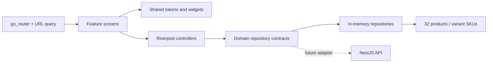

# Frontend architecture

Một ứng dụng Flutter Web, hai shell: StoreShell cho khách và AdminShell cho quản trị. Dùng chung ProviderScope và repository; thay giá/tồn kho trong Admin có hiệu lực ngay trong storefront. Đây là mô phỏng một phiên trình duyệt, không mô phỏng bảo mật đa người dùng.

## Những quyết định đã triển khai

| Quyết định | Lý do / giới hạn |
|---|---|
| Flutter + Riverpod + go_router | Dependency injection, shared state, deep links, query filters |
| Hash URL | Chạy trên static host; quyết định SEO riêng ở `seo-strategy.md` |
| ScrollView thuộc từng route | Tránh reparent Navigator gây lỗi semantics/scroll và giữ bộ lọc theo URL |
| NoTransitionPage | Chuyển trang trực tiếp kiểu web, tránh motion trang trí |
| VNĐ là số nguyên | Không sai số float; format tập trung ở `core/format.dart` |
| SKU là định danh biến thể | Giá/tồn kho dựa trên size+màu, không dựa tên sản phẩm |
| Checkout snapshot + khóa giỏ | Không mất món thêm trong lúc checkout; kiểm tra tồn kho và giá ngay trước khi trừ |
| Catalog revision | CRUD/checkout làm mới catalog và Detail, kể cả người dùng đã rời checkout |
| Không persistence | Refresh khôi phục fixture; không lưu ảnh, mật khẩu, địa chỉ vào localStorage |
| Ảnh local + CanvasKit local | Demo không gửi dữ liệu ảnh cá nhân qua mạng |

## Modules

`domain/catalog.dart`: Product, ProductVariant, ProductMedia, ProductQuery, ProductPage, ProductRepository. Category là map mã→nhãn của fixture; giá integer VND; maxPrice nullable nghĩa là không giới hạn. ProductMedia có path/label/color, gallery hỗ trợ nhiều ảnh nhưng fixture chỉ có một ảnh nguồn/kiểu. `availableColors()` cung cấp facets từ toàn catalog active, refresh theo catalogRevision.

`domain/commerce.dart`: CartItem là snapshot SKU/name/price/image/size/color, CheckoutDraft, Order, CartRepository, OrderRepository. Các list snapshot được giữ bất biến. Trừ kho mock là thao tác atomic trong một isolate sau bước await; không phải bảo đảm giao dịch nhiều máy chủ.

`domain/ai.dart`: StylistRequest/Reply, TryOnJob/Status, StylistRepository, TryOnRepository. Recommendation chỉ chọn sản phẩm và biến thể còn hàng từ catalog. Giá được lấy theo size/color yêu cầu, tổng không vượt budget.

`domain/account.dart`: UserProfile và AccountRepository cho sign-in/register, lưu hồ sơ, khôi phục mật khẩu và sign-out. `data/mock_account.dart` cung cấp latency/lỗi demo, không lưu hoặc xác thực mật khẩu. Controller có generation guard để response cũ không khôi phục tài khoản sau logout/reset. UI có busy, validation, lỗi và retry.

`domain/account_details.dart` và `app/account_details.dart`: sổ địa chỉ + sở thích thời trang qua AsyncNotifier và repository riêng theo email phiên demo. Không lưu dữ liệu cá nhân vào browser storage. Các page account dùng AccountFrame/AccountNavigation; checkout áp dụng địa chỉ bằng lựa chọn chủ động, Stylist áp dụng sở thích qua nút riêng. OrdersPage có search/status filter và OrderProgress; registry Try-On chỉ giữ metadata trong tab, giới hạn20, không chứa ảnh.

`features/admin/admin_state.dart`: cấu hình promotion, nội dung draft và audit trong phiên. Content/promotions chưa có remote repository; adapter cho hai nhóm này là phần nối tiếp cần thêm, giữ giao diện form hiện có.

## Quyền riêng tư Try-On

Picker nhận JPEG/PNG ≤8MB, kiểm tra magic bytes, giải mã và kiểm tra ≤12MP. Frame decoded/codec được dispose; ảnh hợp lệ chỉ giữ trong state của route. Xóa/thay/rời trang gọi evict trên MemoryImage và bỏ bytes, hủy stream/generation để job cũ không khôi phục kết quả. Giải mã hiện xảy ra trước kiểm tra pixel count; backend sau này cần kiểm tra header, giới hạn bộ nhớ và xử lý ảnh riêng.

Không tạo upload request; mock job nhận consent + SKU, không nhận bytes. Activity chỉ lưu feature/status/thời điểm, tối đa 100 entry. Preview ảnh không phải kết quả AI, không có chức năng tải “ảnh AI” giả.

`features/virtual_tryon/tryon_results.dart` giữ tối đa20 kết quả metadata (id/slug/SKU) trong RAM để mở result route. Không lưu bytes hoặc tên file; rời picker vẫn giải phóng ảnh. Xóa/reset/refresh làm result route hết hạn. Picker đang đọc khóa run/retry; callbacks so selectionVersion để không áp dụng kết quả của ảnh cũ.

## Khi nối NestJS

Thay dependency bindings ở `app/providers.dart`, `commerce_state.dart`, `ai_providers.dart`, `account_state.dart`; mapping DTO và lỗi ở adapter. UI không gọi HTTP. Các getter đồng bộ của cart/order dùng cache state phía adapter; mutations `remove/clear/setStatus` hiện đồng bộ cần controller async khi tích hợp để báo pending/error. Product `consumeStock` chỉ phục vụ mock: remote checkout là endpoint atomic duy nhất, tuyệt đối không gọi endpoint trừ kho riêng từ trình duyệt.

TryOnRepository stream ánh xạ SSE/polling phía server; thêm upload/image-reference service sau consent. Hủy local không đồng nghĩa xóa ảnh ở server: DELETE ảnh/job phải có kết quả xác nhận và retry. RBAC, session, checkout idempotency, transactions và quota phải thuộc backend. Chi tiết request/response ở `api-contracts-frontend.md`.
