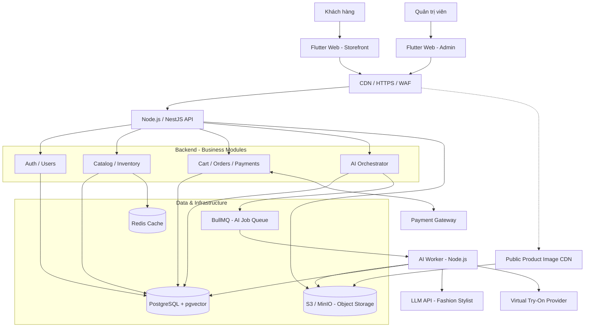
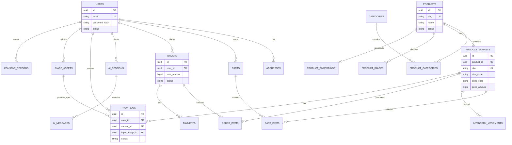
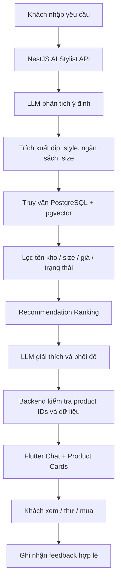
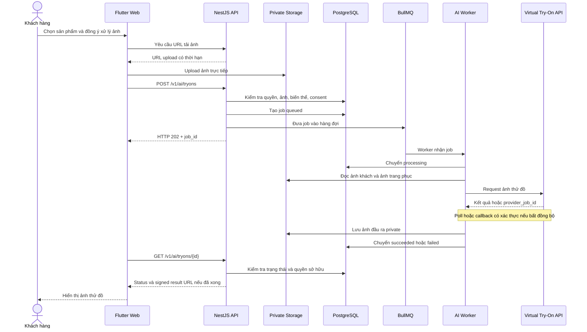

# ĐẶC TẢ DỰ ÁN — FASHION AI COMMERCE

> **Tài liệu bàn giao cho AI Agent triển khai hệ thống**  
> **Phiên bản:** 1.0  
> **Ngày lập:** 13/10/2026  
> **Ngôn ngữ sản phẩm:** Tiếng Việt (có khả năng mở rộng đa ngôn ngữ)  
> **Tech stack chính:** Flutter Web · Node.js / NestJS · TypeScript · PostgreSQL · Redis / BullMQ · AI Stylist · Virtual Try-On

---

## 0. Hướng dẫn dành cho AI Agent

### 0.1. Mục tiêu của Agent

Sử dụng tài liệu này làm **nguồn đặc tả yêu cầu và định hướng kiến trúc** để phân tích, lập kế hoạch, xây dựng, kiểm thử và từng bước hoàn thiện website thương mại điện tử chuyên kinh doanh quần áo, có hai khả năng AI:

1. **AI Fashion Stylist:** tư vấn phong cách và đề xuất sản phẩm có thật trong cửa hàng theo ngân sách, nhu cầu, kích thước và sở thích của khách hàng.
2. **Virtual Try-On:** khách hàng cung cấp ảnh hợp lệ và lựa chọn trang phục để hệ thống tạo ảnh mô phỏng mặc thử thông qua dịch vụ AI.

Agent cần **triển khai theo từng giai đoạn**, ưu tiên một hệ thống mua hàng chính xác, bảo mật, có khả năng vận hành trước khi mở rộng tính năng AI.

### 0.2. Quy tắc thực thi

- Xem các lựa chọn công nghệ và ràng buộc ghi trong tài liệu là baseline; ghi rõ lý do nếu cần thay đổi.
- Ưu tiên **Modular Monolith + AI Worker riêng** cho phiên bản đầu, không tự ý mở rộng thành hệ thống microservices phức tạp.
- Dùng Flutter Web cho frontend và Node.js/NestJS cho backend chính. Không thay thế stack khi chưa có lý do kỹ thuật đáng kể.
- Thiết kế **API contract, ERD, migration và luồng nghiệp vụ** trước khi xây dựng các tính năng liên quan.
- Mọi API key và thông tin bí mật phải ở backend/secret manager; **không nhúng vào Flutter Web**.
- Không tạo giá, tồn kho, sản phẩm hoặc kết quả thanh toán giả làm dữ liệu thực.
- Không yêu cầu ảnh cá nhân nếu người dùng chỉ muốn được tư vấn thời trang bằng văn bản.
- Không coi Virtual Try-On là công cụ đo size chính xác.
- Với AI/Payment provider, xây adapter/interface; khi thiếu khóa API hoặc tài khoản thật, chỉ dùng mock **được gắn nhãn rõ**, không đánh đồng mock với tích hợp sản xuất.
- Các thay đổi ảnh hưởng đến bảo mật, thanh toán, xóa dữ liệu hoặc migration cần có test phù hợp.
- Duy trì `README.md`, `.env.example`, sơ đồ hệ thống, mô tả API và hướng dẫn chạy local trong repository.
- Các quyết định chưa có thông tin (nhà cung cấp thanh toán, vận chuyển, số lượt thử đồ miễn phí, chính sách lưu ảnh...) phải được ghi ở phần **Open Decisions**, dùng giá trị cấu hình/tạm thời thay vì giả định cố định trong code.

### 0.3. Kết quả bàn giao kỳ vọng

1. Mã nguồn monorepo chạy được local bằng hướng dẫn thống nhất.
2. Ứng dụng Flutter Web dành cho khách hàng và quản trị viên.
3. Backend NestJS với API REST đã được tài liệu hóa bằng OpenAPI/Swagger.
4. PostgreSQL schema, migration, seed data mẫu; Redis và AI Worker.
5. Luồng sản phẩm → giỏ hàng → đặt hàng → thanh toán được kiểm thử.
6. Chatbot tư vấn và sản phẩm gợi ý lấy từ dữ liệu catalog thật.
7. Luồng thử đồ ảo bất đồng bộ có upload ảnh riêng tư, queue, trạng thái tác vụ, lưu kết quả, xóa ảnh.
8. Unit/integration/e2e test, CI/CD, bảo mật cơ bản và observability.
9. Tài liệu kiến trúc, ERD, sơ đồ luồng và hướng dẫn triển khai.

---

## I. Tổng quan và mục tiêu

### 1. Mục tiêu sản phẩm

Xây dựng website thương mại điện tử quần áo hiện đại, dễ sử dụng, kết hợp mua sắm trực tuyến và AI để cá nhân hóa trải nghiệm. Hệ thống cần giúp khách hàng:

- Tìm kiếm, lọc, xem và mua quần áo có biến thể size/màu rõ ràng.
- Được AI tư vấn outfit/phong cách phù hợp với dịp sử dụng, sở thích, ngân sách và size.
- Nhìn thấy hình ảnh **mô phỏng** bản thân đang mặc trang phục trước khi quyết định mua.
- Có trải nghiệm mua hàng thuận tiện trên máy tính, tablet và điện thoại.

Ba phân hệ cốt lõi:

| Phân hệ | Vai trò |
|---|---|
| E-commerce | Sản phẩm, danh mục, biến thể, tồn kho, giỏ hàng, đơn hàng, thanh toán, vận chuyển |
| AI Fashion Stylist | Chatbot tư vấn, phối outfit, tìm kiếm và gợi ý sản phẩm có trong catalog |
| Virtual Try-On | Tải ảnh người dùng có đồng ý, tạo ảnh mặc thử và xem kết quả |

### 2. Kiến trúc đề xuất

**Chọn Modular Monolith + AI Worker độc lập** trong MVP:

- **Frontend:** Flutter Web + Dart, tách `storefront` và `admin`.
- **Backend chính:** Node.js + NestJS + TypeScript.
- **Dữ liệu nghiệp vụ:** PostgreSQL + Prisma.
- **Gợi ý ngữ nghĩa:** PostgreSQL + extension `pgvector`.
- **Cache và job queue:** Redis + BullMQ.
- **Hình ảnh:** S3 hoặc MinIO; private bucket/namespace cho ảnh khách hàng.
- **AI tư vấn:** OpenAI Responses API hoặc Gemini API thông qua adapter.
- **AI thử đồ:** FASHN AI hoặc Google Virtual Try-On thông qua adapter.
- **Triển khai:** Docker + reverse proxy/CDN + HTTPS; tiến đến hạ tầng quản lý khi cần.

**Nguyên tắc:** tác vụ Virtual Try-On chạy **bất đồng bộ**, không giữ HTTP request chờ model xử lý. Chat AI có thể trả lời trực tiếp/streaming khi phù hợp.

### 3. Lưu ý về Flutter Web và SEO

Flutter Web phù hợp với giao diện tương tác nhưng có hạn chế về SEO đối với trang sản phẩm cần được lập chỉ mục. Nếu organic SEO là kênh tăng trưởng quan trọng, hãy đánh giá bổ sung lớp HTML/SSR hoặc kiến trúc hybrid cho các landing/catalog pages công khai. Quyết định này cần được ghi rõ trong ADR vì có thể ảnh hưởng toàn bộ chiến lược frontend.

---

## II. Phân tích chức năng

### 1. Dành cho khách hàng

| Nhóm | Chức năng | Ưu tiên |
|---|---|---|
| Tài khoản | Đăng ký, đăng nhập, quên mật khẩu, thông tin hồ sơ | MVP |
| Catalog | Danh mục, bộ sưu tập, thương hiệu, chi tiết sản phẩm | MVP |
| Tìm kiếm và lọc | Từ khóa, giá, size, màu, phong cách, phân trang | MVP |
| Biến thể sản phẩm | Xem và chọn size, màu, giá, số lượng khả dụng | MVP |
| Giỏ hàng | Thêm, cập nhật số lượng, xóa sản phẩm | MVP |
| Checkout | Địa chỉ, phí giao hàng, phương thức thanh toán | MVP |
| Thanh toán | COD và một cổng thanh toán trực tuyến | MVP |
| Đơn hàng | Lịch sử và theo dõi trạng thái | MVP |
| AI Stylist | Chatbot tư vấn theo hoàn cảnh/ngân sách/phong cách | MVP mở rộng |
| AI Recommendation | Gợi ý dựa trên catalog, sở thích, hành vi hợp lệ | MVP mở rộng |
| Virtual Try-On | Tải ảnh, chọn sản phẩm, xem ảnh mô phỏng | MVP mở rộng |
| Yêu thích | Lưu danh sách sản phẩm | Giai đoạn 2 |
| Đánh giá | Xếp hạng, nhận xét, ảnh minh họa | Giai đoạn 2 |
| Đổi trả | Yêu cầu đổi trả và hoàn tiền | Giai đoạn 2 |
| Nâng cao | Phối nhiều sản phẩm thành outfit, cá nhân hóa sâu | Giai đoạn 3 |

#### Các tình huống sử dụng chính

**Use case A — Mua hàng:** khách xem danh mục → lọc → chọn biến thể → thêm giỏ → checkout → thanh toán → xem trạng thái đơn.

**Use case B — AI Stylist:** khách nhập “Tôi cần outfit đi làm, phong cách tối giản, ngân sách dưới 1.500.000đ, áo size M” → hệ thống tìm sản phẩm phù hợp đang bán → AI giải thích cách phối đồ → khách chọn xem/mua.

**Use case C — Virtual Try-On:** khách chọn áo → nhấn “Thử đồ bằng AI” → đọc chính sách và đồng ý → tải ảnh → hệ thống xử lý → xem ảnh kết quả → thử lại hoặc thêm sản phẩm vào giỏ.

### 2. Dành cho quản trị viên

| Module | Các chức năng |
|---|---|
| Dashboard | Doanh thu, đơn hàng, khách hàng, sản phẩm bán chạy |
| Sản phẩm | CRUD, hình ảnh, mô tả, danh mục, trạng thái kinh doanh |
| Biến thể và kho | SKU, size, màu, giá, nhập/xuất/điều chỉnh tồn kho |
| Đơn hàng | Xác nhận, đóng gói, giao hàng, hủy, hoàn tiền |
| Khách hàng | Thông tin tài khoản, lịch sử giao dịch, hỗ trợ |
| Khuyến mãi | Voucher, chiến dịch giảm giá, banner |
| Nội dung | Bảng size, thông tin chất liệu, metadata SEO |
| AI | Cấu hình nhà cung cấp, quota, chi phí, theo dõi lỗi và kiểm duyệt |
| Phân tích | Doanh thu, CTR đề xuất, lượt thử đồ, conversion |
| Phân quyền | Admin, nhân viên bán hàng, CSKH |
| Audit | Nhật ký thay đổi giá, kho, quyền và trạng thái đơn |

### 3. Các quy tắc nghiệp vụ bắt buộc

1. Mỗi biến thể có **SKU duy nhất**, ví dụ `SHIRT-001-BLACK-M`.
2. Không được bán vượt lượng tồn khả dụng; việc đặt giữ tồn phải là thao tác nguyên tử.
3. Backend tính lại giá, khuyến mãi, phí giao hàng tại thời điểm checkout.
4. Đơn hàng lưu **snapshot** tên sản phẩm, SKU, size/màu, đơn giá và địa chỉ giao hàng.
5. Không xác nhận thanh toán dựa trên redirect từ frontend; phải dựa trên tín hiệu được xác thực từ payment gateway.
6. AI chỉ được đề xuất ID sản phẩm có thật; Backend xác minh lại giá, tồn và size.
7. Upload ảnh cá nhân chỉ được xử lý khi có sự đồng ý rõ ràng và phạm vi quyền sử dụng hợp lệ.
8. Ảnh Try-On chỉ mang tính mô phỏng, không thay thế bảng size hoặc cam kết độ vừa vặn.
9. Tác vụ AI có thể chạy lại, callback trùng hoặc hết thời gian: xử lý **idempotent**.
10. Khi người dùng yêu cầu xóa ảnh, các bản lưu và tác vụ liên quan phải được xử lý theo chính sách đã công bố, bao gồm nhà cung cấp bên thứ ba ở mức có thể kiểm soát.

---

## III. Kiến trúc tổng thể

### 1. Sơ đồ hệ thống



> Ghi chú: đường dữ liệu trên là sơ đồ logic. Việc cấp presigned upload/download URL, truy cập private bucket và kết nối trực tiếp giữa client và object storage phải tuân theo phân quyền và CORS.

### 2. Vai trò từng tầng

#### Flutter Web

- Render giao diện catalog, giỏ hàng, checkout, chat AI, thử đồ.
- Quản lý state, routing và tương tác ảnh.
- Không trực tiếp truy cập database hoặc nắm giữ secret của AI/payment.

#### NestJS Backend

- Xác thực, phân quyền và kiểm tra mọi input.
- Truy cập dữ liệu nghiệp vụ và quản lý transaction.
- Điều phối payment, recommendation, AI Stylist và Try-On.
- Tạo job, cấp quyền upload/download, kiểm tra quyền sở hữu tài nguyên.

#### PostgreSQL

- Lưu users, roles, catalog, variants, inventories, orders, payments, AI sessions, jobs và metadata ảnh.
- Dùng JSONB ở những vùng dữ liệu có cấu trúc linh hoạt; không lạm dụng thay thế các bảng quan hệ.
- Dùng `pgvector` cho tìm kiếm tương đồng embedding.

#### Redis / BullMQ

- Cache catalog và dữ liệu không nhạy cảm, có cơ chế invalidation.
- Hàng đợi tác vụ Try-On, embeddings, cleanup và thông báo.
- Retry có backoff, dead-letter hoặc cơ chế theo dõi job thất bại.

#### S3 / MinIO

- Lưu ảnh sản phẩm, ảnh đầu vào/đầu ra của AI.
- **Ảnh người dùng là private**; DB lưu object key và metadata, không lưu ảnh dạng blob.
- Thiết lập thời hạn lưu dữ liệu, quyền truy cập và cơ chế xóa.

#### AI Providers

- Stylist: LLM + tool calling + structured output + dữ liệu catalog.
- Recommendation: bộ lọc nghiệp vụ + vector search + ranking.
- Try-On: mô hình image-to-image chuyên dụng, xử lý thông qua AI Worker.

### 3. Lý do không dùng Microservices toàn phần từ đầu

Microservices tăng chi phí giao tiếp, logging phân tán, DevOps và quản lý giao dịch. Modular Monolith giúp làm MVP nhanh hơn. Tách worker AI trước vì đây là nhóm tác vụ có độ trễ và khả năng scale khác với API thông thường. Chỉ tách service khác khi đã có bằng chứng tải/chi phí/team ownership.

---

## IV. Phân tích và thiết kế cơ sở dữ liệu

### 1. Công nghệ

- **PostgreSQL** là nguồn dữ liệu nghiệp vụ chính do có transaction, constraint, unique index và quan hệ rõ ràng.
- **Prisma ORM** quản lý schema, truy vấn và migration.
- **pgvector** phục vụ semantic retrieval.
- **Redis** chỉ làm cache/queue, không phải nguồn dữ liệu giao dịch đáng tin cậy.

### 2. Sơ đồ ERD



> Đây là **ERD logic rút gọn**. ERD vật lý cần bổ sung FK, unique, index, enum, timestamps, hành vi xóa và quan hệ đầu ra ảnh Try-On.

### 3. Nhóm bảng người dùng/phân quyền

| Bảng | Trường tiêu biểu | Chức năng |
|---|---|---|
| `users` | `id`, `email`, `password_hash`, `full_name`, `phone`, `status`, `created_at` | Tài khoản |
| `roles` | `id`, `name`, `description` | Vai trò |
| `user_roles` | `user_id`, `role_id` | Gán vai trò |
| `addresses` | `id`, `user_id`, `recipient_name`, `phone`, `address`, `is_default` | Địa chỉ nhận hàng |
| `style_profiles` | `user_id`, `preferred_styles`, `preferred_colors`, `size_preferences`, `budget_range` | Sở thích do khách cung cấp hoặc đồng ý sử dụng |
| `consent_records` | `id`, `user_id`, `purpose`, `policy_version`, `granted_at`, `withdrawn_at` | Theo dõi đồng ý dữ liệu |

Không suy luận và lưu các đặc điểm nhạy cảm từ ảnh khi không cần thiết hoặc không có cơ sở pháp lý phù hợp.

### 4. Nhóm sản phẩm/kho

| Bảng | Trường tiêu biểu | Chức năng |
|---|---|---|
| `categories` | `id`, `parent_id`, `name`, `slug` | Danh mục phân cấp |
| `products` | `id`, `name`, `slug`, `description`, `brand`, `status` | Sản phẩm gốc |
| `product_categories` | `product_id`, `category_id` | Danh mục của sản phẩm |
| `product_variants` | `id`, `product_id`, `sku`, `size_code`, `color_code`, `price_amount`, `stock_on_hand`, `stock_reserved` | SKU/màu/size |
| `product_images` | `id`, `product_id`, `variant_id`, `object_key`, `image_type`, `sort_order` | Ảnh sản phẩm |
| `inventory_movements` | `id`, `variant_id`, `quantity_delta`, `reason`, `reference_id`, `created_at` | Sổ biến động kho |

Ví dụ:

| SKU | Màu | Size | Tồn kho |
|---|---|---|---:|
| `P001-BLK-S` | Đen | S | 12 |
| `P001-BLK-M` | Đen | M | 20 |
| `P001-BLK-L` | Đen | L | 15 |
| `P001-WHT-M` | Trắng | M | 18 |

**Công thức tồn kho:**

```text
available_stock = stock_on_hand - stock_reserved
```

Checkout phải kiểm tra và giữ hàng trong transaction có khóa/atomic update. Nếu thanh toán thất bại hoặc hết hạn giữ hàng, cần giải phóng số lượng reserved. Định nghĩa rõ vòng đời reservation và tránh giữ hàng vĩnh viễn.

### 5. Nhóm giỏ hàng/đơn hàng/thanh toán

| Bảng | Trường tiêu biểu | Chức năng |
|---|---|---|
| `carts` | `id`, `user_id`, `guest_session_id`, `updated_at` | Giỏ hàng |
| `cart_items` | `cart_id`, `variant_id`, `quantity` | Chi tiết giỏ |
| `orders` | `id`, `user_id`, `order_code`, `subtotal`, `discount_amount`, `shipping_fee`, `total_amount`, `status`, `address_snapshot` | Đơn hàng |
| `order_items` | `order_id`, `variant_id`, `sku_snapshot`, `name_snapshot`, `size_snapshot`, `unit_price`, `quantity` | Dòng hàng snapshot |
| `payments` | `id`, `order_id`, `provider`, `provider_transaction_id`, `amount`, `status`, `paid_at` | Giao dịch |
| `payment_webhook_events` | `provider`, `event_id`, `received_at`, `processed_at` | Chống webhook trùng |
| `shipments` | `id`, `order_id`, `carrier`, `tracking_code`, `status` | Vận chuyển |

Hai vòng đời trạng thái riêng:

- `order_status`: `pending`, `confirmed`, `processing`, `shipped`, `delivered`, `cancelled`, `returned`.
- `payment_status`: `pending`, `paid`, `failed`, `refunded`, `partially_refunded`.

COD có thể đã được xác nhận đơn nhưng thanh toán vẫn đang `pending`.

### 6. Nhóm AI

| Bảng | Trường tiêu biểu | Chức năng |
|---|---|---|
| `ai_sessions` | `id`, `user_id`, `context`, `created_at` | Phiên chat |
| `ai_messages` | `id`, `session_id`, `role`, `content`, `created_at` | Tin nhắn |
| `product_embeddings` | `product_id`, `embedding`, `model_name`, `updated_at` | Vector sản phẩm |
| `recommendation_events` | `user_id`, `product_id`, `event_type`, `session_id`, `created_at` | Đo hiệu quả gợi ý |
| `image_assets` | `id`, `owner_user_id`, `object_key`, `purpose`, `mime_type`, `expires_at` | Metadata ảnh |
| `tryon_jobs` | `id`, `user_id`, `variant_id`, `input_image_id`, `output_image_id`, `provider`, `provider_job_id`, `status`, `error_code`, `idempotency_key` | Nhiệm vụ thử đồ |
| `ai_usage_logs` | `id`, `user_id`, `feature`, `provider`, `model`, `usage_units`, `estimated_cost`, `created_at` | Theo dõi chi phí |

Lưu ý khi thiết kế vật lý: phiên chat khách vãng lai, retention, soft delete và dữ liệu sự kiện có thể cần các trường bổ sung tùy phạm vi sản phẩm.

### 7. Ràng buộc và index

```sql
-- SKU là duy nhất.
CREATE UNIQUE INDEX uq_variant_sku
ON product_variants (sku);

-- Tổ hợp sản phẩm / màu / size duy nhất nếu nghiệp vụ chỉ có một SKU mỗi tổ hợp.
CREATE UNIQUE INDEX uq_product_color_size
ON product_variants (product_id, color_code, size_code);

-- Lịch sử đơn hàng.
CREATE INDEX idx_orders_user_created
ON orders (user_id, created_at DESC);

-- Lịch sử tác vụ thử đồ.
CREATE INDEX idx_tryon_user_created
ON tryon_jobs (user_id, created_at DESC);

-- Vector: yêu cầu cột embedding đã được khai báo đúng kiểu vector/chiều.
CREATE INDEX idx_product_embedding_hnsw
ON product_embeddings
USING hnsw (embedding vector_cosine_ops);
```

Các ràng buộc bổ sung:

- `price_amount >= 0`, `stock_on_hand >= 0`, `stock_reserved >= 0`.
- `stock_reserved <= stock_on_hand`.
- `cart_items` unique `(cart_id, variant_id)`.
- `payment_webhook_events` unique `(provider, event_id)`.
- `tryon_jobs` unique `(user_id, idempotency_key)` khi có khóa.
- `order_code` unique; `products.slug` unique.
- Embedding phải đồng nhất model và chiều vector theo chỉ mục.
- Dùng `BIGINT` cho số tiền VND hoặc đơn vị nhỏ nhất của tiền tệ, tránh `FLOAT` cho tiền.
- Dùng timestamp UTC trong DB và chuyển sang múi giờ hiển thị ở client.
- Đảm bảo migrations chạy được từ database rỗng.

---

## V. Cấu trúc thư mục dự án

### 1. Monorepo

```text
fashion-ai-commerce/
├── apps/
│   ├── storefront/          # Flutter Web - Khách hàng
│   ├── admin/               # Flutter Web - Quản trị
│   ├── api/                 # NestJS REST API
│   └── ai-worker/           # Node.js workers / BullMQ
├── packages/
│   └── api-contract/        # OpenAPI/schema, contracts chung
├── infrastructure/
│   ├── docker/
│   ├── nginx/
│   ├── terraform/
│   └── monitoring/
├── docs/
│   ├── architecture/
│   ├── database/
│   ├── api/
│   └── ai-evaluation/
├── .github/workflows/
├── docker-compose.yml
├── .env.example
└── README.md
```

### 2. Flutter Web: Feature-first + Clean Architecture

```text
apps/storefront/
├── lib/
│   ├── main.dart
│   ├── app/
│   │   ├── app.dart
│   │   ├── router.dart
│   │   └── theme.dart
│   ├── core/
│   │   ├── config/
│   │   ├── network/
│   │   ├── errors/
│   │   ├── widgets/
│   │   └── utils/
│   ├── features/
│   │   ├── auth/
│   │   ├── home/
│   │   ├── catalog/
│   │   ├── product_detail/
│   │   ├── cart/
│   │   ├── checkout/
│   │   ├── orders/
│   │   ├── ai_stylist/
│   │   ├── virtual_tryon/
│   │   └── profile/
│   └── l10n/
├── assets/
│   ├── images/
│   ├── icons/
│   └── fonts/
├── test/
├── integration_test/
├── web/
└── pubspec.yaml
```

Mẫu cấu trúc trong một feature:

```text
features/virtual_tryon/
├── data/
│   ├── datasources/tryon_remote_datasource.dart
│   ├── models/tryon_job_dto.dart
│   └── repositories/tryon_repository_impl.dart
├── domain/
│   ├── entities/tryon_job.dart
│   ├── repositories/tryon_repository.dart
│   └── usecases/create_tryon_job.dart
└── presentation/
    ├── pages/tryon_page.dart
    ├── widgets/
    │   ├── image_upload.dart
    │   └── tryon_comparison.dart
    └── providers/tryon_provider.dart
```

Flutter packages gợi ý:

| Nhu cầu | Thư viện |
|---|---|
| Routing | `go_router` |
| State management | `flutter_riverpod` |
| HTTP | `dio` |
| JSON/models | `json_serializable`, `freezed` |
| Chọn ảnh | `image_picker`, `file_picker` (kiểm tra hỗ trợ web/phiên bản) |
| Responsive | `LayoutBuilder`, `MediaQuery` |
| Đa ngôn ngữ | `flutter_localizations`, `intl` |
| Test | `flutter_test`, `integration_test` |

Tạo `apps/admin/` như ứng dụng riêng, có thể tái sử dụng package theme/UI; **không** dùng kiểm soát hiển thị UI để thay thế phân quyền backend.

### 3. Backend NestJS

```text
apps/api/
├── src/
│   ├── main.ts
│   ├── app.module.ts
│   ├── config/
│   │   ├── database.config.ts
│   │   ├── auth.config.ts
│   │   ├── redis.config.ts
│   │   └── ai.config.ts
│   ├── common/
│   │   ├── guards/
│   │   ├── decorators/
│   │   ├── filters/
│   │   ├── interceptors/
│   │   └── dto/
│   ├── modules/
│   │   ├── auth/
│   │   ├── users/
│   │   ├── roles/
│   │   ├── catalog/
│   │   ├── inventory/
│   │   ├── cart/
│   │   ├── orders/
│   │   ├── payments/
│   │   ├── promotions/
│   │   ├── uploads/
│   │   ├── recommendations/
│   │   ├── ai-stylist/
│   │   ├── virtual-tryon/
│   │   └── admin/
│   ├── integrations/
│   │   ├── llm/
│   │   ├── tryon-providers/
│   │   ├── storage/
│   │   └── payment-gateways/
│   └── prisma/prisma.service.ts
├── prisma/
│   ├── schema.prisma
│   └── migrations/
├── test/
├── package.json
└── tsconfig.json
```

Ví dụ module:

```text
modules/catalog/
├── catalog.module.ts
├── catalog.controller.ts
├── catalog.service.ts
├── catalog.repository.ts
├── dto/
│   ├── create-product.dto.ts
│   └── update-product.dto.ts
└── entities/product.entity.ts
```

### 4. AI Worker

```text
apps/ai-worker/
├── src/
│   ├── main.ts
│   ├── jobs/
│   │   ├── tryon.processor.ts
│   │   ├── embeddings.processor.ts
│   │   └── cleanup.processor.ts
│   ├── providers/
│   │   ├── fashn.provider.ts
│   │   ├── vertex-tryon.provider.ts
│   │   └── llm.provider.ts
│   ├── services/
│   │   ├── image-validation.service.ts
│   │   ├── image-storage.service.ts
│   │   └── job-status.service.ts
│   └── config/
├── test/
└── package.json
```

---

## VI. Luồng AI Fashion Stylist và Recommendations

### 1. Nguyên tắc thiết kế

Không sử dụng LLM để tự bịa danh mục và giá. Dùng **LLM + Retrieval + Business Rules**:

1. LLM trích xuất ý định người dùng.
2. Truy xuất sản phẩm bằng bộ lọc cấu trúc + semantic search.
3. Lọc hard constraints: active, tồn kho, size, giá.
4. Xếp hạng, phối outfit theo danh sách thực.
5. LLM giải thích bằng dữ liệu sản phẩm đã kiểm chứng.
6. Backend kiểm tra ID, quyền truy cập và giá một lần nữa trước phản hồi.

### 2. Sơ đồ



### 3. Input/Output mẫu

**Câu hỏi:**

> Tôi cần một bộ đồ đi phỏng vấn, phong cách thanh lịch, ngân sách dưới 1.500.000 đồng. Tôi thường mặc áo size M.

**Ý định được phân tích:**

```json
{
  "occasion": "job_interview",
  "style": ["formal", "minimalist"],
  "budget_max": 1500000,
  "currency": "VND",
  "size_preferences": { "top": "M" },
  "preferred_colors": [],
  "requested_items": ["outfit"]
}
```

**Response của Backend nên chứa cấu trúc rõ:**

```json
{
  "message": "Gợi ý outfit thanh lịch cho buổi phỏng vấn...",
  "recommended_product_ids": ["product-uuid-1", "product-uuid-2"],
  "outfit_items": [
    { "product_id": "product-uuid-1", "role": "top" },
    { "product_id": "product-uuid-2", "role": "bottom" }
  ],
  "reasons": ["Phù hợp hoàn cảnh", "Trong giới hạn ngân sách"]
}
```

Các UUID trong ví dụ là **placeholder**; response production phải dùng ID thật từ database. Những sản phẩm gợi ý phải có thể click sang product detail.

### 4. Thuật toán xếp hạng khởi đầu

```text
score = 0.40 * relevance
      + 0.25 * preferences
      + 0.20 * outfit_compatibility
      + 0.15 * popularity_or_recency
```

Tất cả thành phần chuẩn hóa về cùng thang điểm. Trọng số chỉ là giả định ban đầu để A/B test. Hard filters (còn hàng, size, giá, trạng thái bán) phải chạy trước scoring.

### 5. Khả năng mở rộng AI Stylist

- Function calling/structured output để truy vấn catalog an toàn.
- Gợi ý bổ sung phụ kiện hoặc outfit theo hoàn cảnh.
- Lưu lịch sử chat nếu người dùng cho phép; có cơ chế xóa.
- Theo dõi CTR sản phẩm gợi ý, add-to-cart rate, purchase conversion, tỷ lệ lỗi hallucination.
- Không cung cấp cho LLM công cụ thay đổi giá, tồn kho hoặc xác nhận thanh toán.
- Giới hạn token, rate limit và theo dõi chi phí.

---

## VII. Luồng Virtual Try-On

### 1. Sơ đồ sequence



### 2. Quy trình chi tiết

**Bước 1 — Chọn sản phẩm:** khách chọn biến thể hoặc sản phẩm; ảnh trang phục phải thích hợp cho mô hình. Không giả định mọi sản phẩm đều hỗ trợ try-on.

**Bước 2 — Quyền và ảnh:** hiển thị mục đích xử lý, thời hạn lưu ảnh và thông tin dịch vụ AI; người dùng đồng ý trước khi upload. Chỉ sử dụng ảnh mình có quyền. Hướng dẫn ảnh đứng đủ sáng. Không bắt buộc lộ mặt nếu provider hỗ trợ.

**Bước 3 — Upload:** API cấp presigned URL thời hạn ngắn; client upload trực tiếp vào private storage. Backend xác thực object tồn tại, ownership, mime thật, kích thước và định dạng, có xử lý EXIF, scan/kiểm tra file theo chính sách.

**Bước 4 — Tạo job:** lưu trạng thái `queued`, đưa vào BullMQ, phản hồi `202 Accepted` + `job_id`. Không chờ inference xong trong HTTP request.

**Bước 5 — Worker:** xác minh quyền và trạng thái, nhận ảnh, chuyển payload theo adapter, gọi provider, polling/callback tùy giao thức, retry có kiểm soát, lưu kết quả.

**Bước 6 — Kết quả:** frontend polling hoặc SSE/WebSocket để cập nhật trạng thái. Backend cấp URL xem kết quả có hạn; UI hiển thị trước/sau, retry, đổi màu, bảng size, thêm giỏ.

**Bước 7 — Xóa dữ liệu:** hỗ trợ xóa ảnh, kết quả; xử lý hủy/từ chối job chưa chạy; thiết kế riêng cho job đang xử lý để tránh tạo lại ảnh sau khi đã yêu cầu xóa.

### 3. Trạng thái job

```text
queued -> processing -> succeeded
                  \-> failed
queued -> cancelled
queued/processing/succeeded -> expired (theo retention/cleanup policy phù hợp)
```

Cần định nghĩa timeout, retry count, error codes, idempotency key, tiến trình hiển thị và cơ chế thu hồi quota nếu provider lỗi.

### 4. Hợp đồng nội bộ với AI Provider

```json
{
  "person_image": "PRIVATE_IMAGE_REFERENCE",
  "garment_image": "PRODUCT_IMAGE_REFERENCE",
  "garment_category": "tops",
  "output_count": 1
}
```

Đây là **schema nội bộ**, không phải payload bắt buộc của FASHN/Google. Adapter ánh xạ sang schema thực tế theo phiên bản API đã xác minh.

### 5. Ràng buộc AI/UX

- Cần kiểm thử hình ảnh ở nhiều tư thế, dáng người, loại quần áo, hoa văn và chất lượng đầu vào.
- Giữ màu sắc, họa tiết và nhận dạng của trang phục càng sát ảnh sản phẩm càng tốt.
- Không cam kết hình ảnh phản ánh fit hay số đo thực tế.
- Tránh lời bình ngoại hình mang tính phán xét.
- UI minh bạch khi lỗi, hết quota, chờ xử lý hoặc provider không hỗ trợ loại trang phục.
- Không sử dụng ảnh khách hàng để huấn luyện mô hình nếu chưa có cơ sở đồng ý phù hợp và điều khoản rõ ràng.

---

## VIII. Thiết kế REST API

### 1. Danh sách endpoint định hướng

| Method | Endpoint | Công dụng |
|---|---|---|
| `POST` | `/v1/auth/register` | Đăng ký |
| `POST` | `/v1/auth/login` | Đăng nhập |
| `POST` | `/v1/auth/refresh` | Gia hạn phiên theo cơ chế auth đã chọn |
| `GET` | `/v1/products` | Tìm kiếm/lọc/phân trang |
| `GET` | `/v1/products/:slug` | Chi tiết sản phẩm |
| `POST` | `/v1/cart/items` | Thêm biến thể vào giỏ |
| `PATCH` | `/v1/cart/items/:id` | Cập nhật số lượng |
| `DELETE` | `/v1/cart/items/:id` | Xóa khỏi giỏ |
| `POST` | `/v1/orders/checkout` | Tạo đơn và reservation |
| `GET` | `/v1/orders/:id` | Chi tiết và trạng thái đơn |
| `POST` | `/v1/payments/webhooks/:provider` | Callback thanh toán được xác minh |
| `POST` | `/v1/ai/stylist/messages` | Nhắn tin và nhận gợi ý |
| `GET` | `/v1/recommendations` | Gợi ý sản phẩm |
| `POST` | `/v1/uploads/presign` | Cấp quyền upload |
| `POST` | `/v1/ai/tryons` | Tạo job Try-On |
| `GET` | `/v1/ai/tryons/:id` | Xem trạng thái job |
| `DELETE` | `/v1/ai/tryons/:id` | Hủy/xóa job theo chính sách |
| `DELETE` | `/v1/images/:id` | Yêu cầu xóa ảnh sở hữu |
| `POST` | `/v1/admin/products` | Tạo sản phẩm (admin) |

### 2. Ví dụ tạo Try-On job

```http
POST /v1/ai/tryons
Authorization: Bearer <access_token>
Content-Type: application/json
Idempotency-Key: 6b35a9c2-...
```

```json
{
  "variant_id": "a-valid-product-variant-uuid",
  "input_image_id": "an-uploaded-image-uuid",
  "consent_id": "a-valid-consent-record-uuid"
}
```

```http
HTTP/1.1 202 Accepted
Content-Type: application/json
```

```json
{
  "job_id": "9b8c7d6e-1234-4567-89ab-abcdef012345",
  "status": "queued",
  "status_url": "/v1/ai/tryons/9b8c7d6e-1234-4567-89ab-abcdef012345"
}
```

### 3. Nguyên tắc API

- Version hóa `/v1`.
- DTO validation, error schema thống nhất, HTTP status đúng ngữ nghĩa.
- OpenAPI/Swagger cho tất cả API.
- Rate limit theo user/IP/token tùy endpoint.
- RBAC với admin; ownership check với đơn hàng, ảnh, AI session và job.
- Pagination tại backend; không trả toàn bộ catalog.
- Idempotency key cho checkout và Try-On creation.
- Webhook payment: xác thực chữ ký, chống replay/trùng, ghi nhận trạng thái atomically.
- Job status không lộ provider credentials hoặc private object path.

---

## IX. Công nghệ AI và phương án tích hợp

### 1. Công nghệ chính

| Công nghệ | Vai trò | Định hướng |
|---|---|---|
| OpenAI Responses API | LLM, tool calling, structured output | MVP AI Stylist |
| Gemini API | Thay thế/đối chứng LLM đa phương thức | Tùy nhu cầu |
| Embedding API + `pgvector` | Semantic retrieval sản phẩm | MVP AI Recommendation |
| FASHN Try-On v1.6 | Thử đồ bằng ảnh | Ứng viên MVP |
| FASHN Try-On Max | Mô hình thử đồ chất lượng cao | Thử nghiệm khi phù hợp |
| Google Virtual Try-On | Managed Try-On trên Google Cloud | Ứng viên thay thế |
| FASHN VTON v1.5 self-host | Tự triển khai PyTorch/GPU | Giai đoạn cần quyền kiểm soát sâu |

Các tên model, khả năng hỗ trợ, API schema, giá, quota và giấy phép **phải xác minh trên tài liệu chính thức tại thời điểm tích hợp**, không hardcode chỉ theo bản thiết kế này.

### 2. Links tham khảo

- OpenAI Responses API: https://platform.openai.com/docs/api-reference/responses
- OpenAI function calling: https://platform.openai.com/docs/guides/function-calling
- FASHN Try-On v1.6: https://docs.fashn.ai/api-reference/tryon-v1-6
- FASHN Try-On Max: https://docs.fashn.ai/api-reference/tryon-max
- Google Virtual Try-On: https://docs.cloud.google.com/gemini-enterprise-agent-platform/models/capabilities/generate-virtual-try-on-images
- pgvector: https://github.com/pgvector/pgvector
- NestJS Queue: https://docs.nestjs.com/techniques/queues
- Flutter Web: https://docs.flutter.dev/platform-integration/web

### 3. Provider abstraction

Nên thiết kế interfaces:

```ts
interface LLMProvider {
  generateStylistResponse(input: StylistInput): Promise<StylistOutput>;
}

interface TryOnProvider {
  createJob(input: TryOnInput): Promise<ProviderJobResult>;
  getJobStatus(providerJobId: string): Promise<ProviderJobStatus>;
}
```

Các kiểu `StylistInput`, `StylistOutput`, `TryOnInput`, `ProviderJobResult` là hợp đồng nội bộ cần khai báo đầy đủ khi code; methods có thể được bổ sung tùy provider hỗ trợ callback hay đồng bộ.

### 4. Phương án tự host AI khi cần

```text
NestJS / BullMQ Worker
        |
        v
Python FastAPI Inference Service
        |
        v
PyTorch + Virtual Try-On Model
        |
        v
GPU Inference
        |
        v
Private Object Storage
```

Chỉ đánh giá self-host GPU sau khi có số liệu lượt thử, tỷ lệ lỗi, chi phí API, latency và chi phí vận hành GPU. Kiểm tra giấy phép code + model weights + dependency trước sử dụng thương mại.

### 5. Đánh giá chất lượng AI

| Tiêu chí | Stylist/Recommendation | Virtual Try-On |
|---|---|---|
| Accuracy | Đúng giá, tồn kho, sản phẩm | Giữ màu/chất liệu/họa tiết |
| Relevance | Dịp, style, ngân sách, size | Tương thích ảnh và danh mục |
| Quality | Giải thích hữu ích, ít hallucination | Tự nhiên, ít biến dạng |
| Latency | Time-to-first-response, p95 | Queue time, processing time |
| Cost | Chi phí mỗi phiên tư vấn | Chi phí mỗi ảnh thành công |
| UX | CTR, add-to-cart, phản hồi | Tỷ lệ hoàn tất, hài lòng |

Tập dữ liệu kiểm thử cần đa dạng về trang phục, tư thế, sắc độ, ánh sáng và chất lượng ảnh; không chọn provider chỉ dựa trên demo marketing.

---

## X. Bảo mật, quyền riêng tư và vận hành

### 1. Tài khoản và API

- Bắt buộc HTTPS/TLS.
- Hash mật khẩu bằng Argon2id hoặc thuật toán phù hợp đã được kiểm chứng.
- Quản lý session/token an toàn; cân nhắc refresh token trong `HttpOnly`, `Secure`, `SameSite` cookie và CSRF defense.
- MFA cho admin.
- RBAC, object-level authorization; ngăn IDOR/BOLA.
- Validate input chặt chẽ, chống SQL injection, XSS, CSRF và upload độc hại theo kiến trúc thực tế.
- Secrets trong secret manager/env an toàn, không commit `.env`.
- Audit log cho các hành động nhạy cảm (giá, tồn kho, quyền, hoàn tiền).

### 2. Bảo vệ ảnh cá nhân

- Ảnh user và kết quả Try-On dùng private bucket/namespace.
- Chỉ cấp signed URL khi đã kiểm tra quyền, TTL ngắn.
- Xác minh file thực tế tại backend/storage processing; giới hạn MIME, size, resolution, loại bỏ EXIF không cần.
- Không log ảnh, base64, provider prompt nhạy cảm, presigned URLs.
- Có thời hạn lưu và quy trình xóa rõ ràng.
- Chỉ gửi ảnh sang nhà cung cấp AI theo mục đích thông báo và đồng ý.
- Có cơ chế thu hồi đồng ý và xử lý dữ liệu liên quan.
- Rà soát quy định dữ liệu cá nhân tại thị trường phục vụ; trong bối cảnh Việt Nam cần đối chiếu pháp luật hiệu lực tại thời điểm triển khai và đánh giá về chuyển dữ liệu cho bên thứ ba/ra nước ngoài.

### 3. Bảo mật AI

- Coi nội dung chat, mô tả sản phẩm và dữ liệu trích xuất là dữ liệu không đáng tin, phòng prompt injection.
- LLM không được tự thay đổi giá, tồn, quyền hoặc trạng thái đơn.
- Chỉ cấp tool quyền đọc có phạm vi tối thiểu.
- Kiểm tra output (ID sản phẩm, giá, schema) từ Backend trước khi gửi UI.
- Rate limit, token budget, quota người dùng, kiểm soát abuse và chi phí.

### 4. Hiệu suất — Mục tiêu ban đầu

| Chỉ tiêu | Mục tiêu đề xuất |
|---|---|
| Catalog API | p95 < 400 ms |
| Checkout API | p95 < 1 giây, không tính thời gian chờ cổng thanh toán |
| Chat AI | Streaming hoặc phản hồi ban đầu sớm |
| Virtual Try-On | Bất đồng bộ, không khóa UI |
| Availability (sau ổn định) | Mục tiêu 99,9% |
| Product images | CDN, responsive sizes, lazy loading |
| Hàng đợi | Concurrency có giới hạn, timeout, retry có kiểm soát |

Các số này là **mục tiêu kỹ thuật**, phải benchmark rồi điều chỉnh.

### 5. Khả năng mở rộng

- API stateless, có thể scale ngang.
- DB indexing, connection pool, loại bỏ N+1 queries.
- Redis cache có invalidation hợp lý.
- Worker độc lập, scale theo queue depth và provider quota.
- CDN cho ảnh sản phẩm; ảnh cá nhân không phát công khai qua CDN nếu thiếu bảo vệ.
- Backup, restore test, point-in-time recovery khi có hỗ trợ.
- Có kế hoạch DR, database migration/rollback hợp lý.

### 6. Observability / testing / DevOps

| Hạng mục | Công cụ gợi ý |
|---|---|
| Error tracking | Sentry |
| Tracing | OpenTelemetry |
| Metrics | Prometheus + Grafana |
| Unit/integration test | Jest, NestJS testing utilities |
| Flutter tests | `flutter_test`, `integration_test` |
| E2E browser | Playwright |
| Load testing | k6 |
| CI/CD | GitHub Actions |
| Packaging | Docker, Docker Compose |

Test trọng yếu:

1. Hai khách mua đồng thời sản phẩm cuối cùng → không oversell.
2. Webhook thanh toán gửi trùng → không ghi nhận hai lần.
3. Payment success đến muộn hoặc sai thứ tự → trạng thái vẫn hợp lệ.
4. AI provider timeout → job kết thúc/lặp lại có kiểm soát.
5. Queue deliver trùng → không xuất ảnh/job trùng ngoài dự kiến.
6. Người A truy cập job/ảnh/order người B → bị từ chối.
7. Người dùng xóa ảnh trong lúc job đang chạy → không rò rỉ/tạo lại ảnh trái chính sách.
8. AI Stylist tạo ID/giá không có trong DB → backend từ chối/loại bỏ.
9. Rate limits/quota Try-On không thể vượt bằng gọi API trực tiếp.
10. Migration và quy trình backup/restore chạy được trong môi trường kiểm thử.

---

## XI. Thiết kế trải nghiệm người dùng

### 1. Định hướng giao diện

- Responsive, mobile-first, phong cách hiện đại/tối giản.
- Trên desktop: điều hướng rõ, catalog grid và bộ lọc thuận tiện.
- Trên mobile: tìm kiếm, biến thể, giỏ hàng và CTA nổi bật.
- Bảng size, chất liệu, phí vận chuyển, đổi trả hiển thị đủ trước checkout.
- Có skeleton/loading/empty states/error states.
- Không bắt người dùng đăng nhập chỉ để duyệt sản phẩm.
- Không yêu cầu ảnh để sử dụng AI Stylist dạng text.
- Tính accessibility: semantic labels, keyboard navigation, tương phản và focus states.

### 2. UX Virtual Try-On

- CTA “Thử đồ bằng AI” chỉ xuất hiện với sản phẩm được hỗ trợ.
- Có hướng dẫn chụp/chọn ảnh và các giới hạn kích thước.
- Yêu cầu consent rõ ràng trước upload.
- Hiển thị trạng thái đang chờ/đang xử lý/thành công/thất bại.
- So sánh trước/sau, phóng to, thử lại và thêm giỏ.
- Có thông báo: **“Ảnh mô phỏng; độ vừa vặn thực tế có thể khác.”**
- Dễ xóa ảnh và kết quả sau khi sử dụng.

---

## XII. Lộ trình phát triển

Giả định nhóm phát triển thực hiện một website B2C, ban đầu có một kho hàng và một thị trường, chưa huấn luyện mô hình AI từ đầu.

| Giai đoạn | Thời lượng ước tính | Nội dung | Kết quả |
|---|---:|---|---|
| 0. Phân tích và thiết kế | 1–2 tuần | User stories, wireframe, ERD, API contracts, AI feasibility | Đặc tả và bản thiết kế |
| 1. E-commerce MVP | 4–6 tuần | Auth, catalog, variants, cart, checkout, admin, thanh toán cơ bản | Mua hàng end-to-end |
| 2. AI Stylist + Recommendation | 2–3 tuần | LLM, embeddings, pgvector, product retrieval, ranking | Chat tư vấn có gợi ý sản phẩm thật |
| 3. Virtual Try-On MVP | 3–4 tuần | Private upload, job queue, provider, trạng thái, ảnh kết quả, xóa | Thử đồ được một nhóm trang phục |
| 4. Hardening và release | 2–3 tuần | Security, load, recovery, UX, monitoring, SEO decisions | Production release |
| 5. Nâng cao | 4–8 tuần | Outfit recommendation, A/B test, loyalty, AI optimization | Nền tảng cá nhân hóa hơn |

- **MVP có AI + Try-On:** khoảng 10–15 tuần trong điều kiện phạm vi và tích hợp thuận lợi.
- **Lộ trình hoàn chỉnh:** khoảng 16–26 tuần tùy nguồn lực/phạm vi.
- Đây là ước lượng ban đầu, không phải cam kết tiến độ.

### Tiêu chí nghiệm thu MVP

- [ ] Khách đăng ký/đăng nhập được và quản lý hồ sơ.
- [ ] Khách xem, tìm kiếm, lọc và chọn biến thể sản phẩm được.
- [ ] Giỏ hàng tính toán đúng và Backend không tin giá gửi từ client.
- [ ] Tạo đơn hàng thành công, có snapshot sản phẩm/địa chỉ.
- [ ] Không oversell khi giao dịch đồng thời.
- [ ] Thanh toán/COD và webhook có kiểm tra nguồn, chống xử lý trùng.
- [ ] Admin quản lý sản phẩm, tồn kho và đơn hàng theo vai trò.
- [ ] AI Stylist dùng sản phẩm thật, không tự bịa giá/SKU.
- [ ] Recommendation lọc được giá, size và tồn kho.
- [ ] Virtual Try-On upload được ảnh riêng tư, tạo job bất đồng bộ.
- [ ] UI theo dõi được kết quả hoặc lỗi job.
- [ ] User không truy cập được ảnh/job/order của user khác.
- [ ] Có consent, cơ chế xóa và quy tắc retention dữ liệu ảnh.
- [ ] Responsive trên desktop/tablet/mobile.
- [ ] Có unit, integration, e2e tests cho luồng trọng yếu.
- [ ] Có logging, monitoring, backup, `.env.example`, README, OpenAPI.

---

## XIII. Triển khai hạ tầng và quản lý chi phí

### 1. MVP deployment

| Hệ thống | Đề xuất |
|---|---|
| Flutter storefront/admin | Static hosting + CDN |
| Backend API | Docker container chạy NestJS |
| AI Worker | Docker container riêng, đọc BullMQ |
| Database | Managed PostgreSQL + pgvector nếu provider hỗ trợ |
| Cache/Queue | Managed Redis |
| Ảnh | S3-compatible object storage |
| AI | Managed AI APIs |
| Logging/Monitoring | Sentry + OpenTelemetry + metrics |
| CI/CD | GitHub Actions |

Không yêu cầu Kubernetes trong MVP. Khi tải tăng, scale API và worker độc lập. Cân nhắc GPU self-host chỉ sau khi có dữ liệu thực.

### 2. Mô hình chi phí

```text
C_total = C_infrastructure + C_AI + C_operations

C_VTO = N_inferences_billed * C_per_image
      + C_storage
      + C_egress
```

Trong đó `N_inferences_billed` bao gồm các lượt xử lý lại mà nhà cung cấp tính phí. Theo dõi chi phí cho mỗi lượt thử **thành công**, không chỉ chi phí mỗi request. Giới hạn lượt thử/ngày theo user hoặc gói dịch vụ nếu cần, không hiển thị con số hạn mức khi chưa cấu hình thật.

---

## XIV. Phân chia công việc cho AI Agent

Đề xuất thực hiện tuần tự theo các chặng có thể kiểm chứng:

### Chặng A — Repository foundation

- [ ] Tạo monorepo theo cấu trúc tại Mục V.
- [ ] Thiết lập Flutter storefront/admin, NestJS API, worker, Prisma, Redis, PostgreSQL và storage local.
- [ ] Tạo Docker Compose và `.env.example`.
- [ ] Thiết lập formatter, linter, test runner, CI cơ bản.
- [ ] Viết `README` hướng dẫn khởi chạy.

**Điều kiện xong:** tất cả service local có thể khởi động; health checks hoạt động; pipeline CI chạy.

### Chặng B — Database và E-commerce

- [ ] Triển khai schema/migrations các nhóm bảng chính.
- [ ] Auth, roles/permissions, catalog, product variants, images.
- [ ] Cart, checkout, stock reservation, orders, payments.
- [ ] Admin CRUD catalog, inventory và orders.
- [ ] Tạo seed demo data hợp lệ và integration tests.

**Điều kiện xong:** hoàn tất luồng đơn hàng có test chống oversell và webhook lặp.

### Chặng C — AI Stylist

- [ ] Tạo `LLMProvider` adapter và prompt có giới hạn rõ.
- [ ] Tạo schema structured output cho intent và kết quả tư vấn.
- [ ] Tạo pipeline embeddings cho catalog và truy vấn pgvector.
- [ ] Hard filters và ranking.
- [ ] Tạo UI chat + product cards, telemetry.
- [ ] Kiểm thử AI không bịa SKU/giá.

**Điều kiện xong:** chat hiển thị sản phẩm thật từ DB, kiểm soát lỗi provider và chi phí.

### Chặng D — Virtual Try-On

- [ ] Tạo flow consent và upload ảnh bảo mật.
- [ ] Tạo bảng `image_assets`, `tryon_jobs` cùng lifecycle state.
- [ ] Triển khai queue + worker + retry + cleanup.
- [ ] Tạo `TryOnProvider` adapter; tích hợp provider thật bằng environment secrets.
- [ ] Tạo UI upload, trạng thái, xem kết quả và xóa ảnh.
- [ ] Test quyền sở hữu, timeout, job duplicate, xóa ảnh và quota.

**Điều kiện xong:** tạo và xem ảnh thử đồ theo flow bất đồng bộ, không rò rỉ dữ liệu người dùng.

### Chặng E — Production hardening

- [ ] Audit bảo mật, rate limit, object-level access checks.
- [ ] Load test catalog/checkout; stress test AI queue.
- [ ] CI/CD, backup/restore, logging/alerts, deployment docs.
- [ ] Responsive/accessibility review.
- [ ] Phân tích SEO quyết định hybrid/SSR nếu cần.

**Điều kiện xong:** thỏa checklist nghiệm thu tại Mục XII.

### Báo cáo AI Agent nên xuất sau mỗi chặng

1. **Đã thực hiện:** danh sách file/module/migration/API đã làm.
2. **Hướng dẫn chạy:** lệnh cài và chạy, biến môi trường cần thiết.
3. **Đã kiểm thử:** test suite và kết quả thực tế; không giả báo pass.
4. **Rủi ro/chưa hoàn tất:** những chức năng đang mock hoặc chờ API key/cấu hình bên thứ ba.
5. **Bước tiếp theo:** task theo thứ tự phụ thuộc kỹ thuật.

---

## XV. Những quyết định còn mở (Open Decisions)

Trước production, cần chốt và ghi vào ADR/config:

| Chủ đề | Câu hỏi cần quyết định | Mặc định trong đặc tả |
|---|---|---|
| Thanh toán | Cổng thanh toán nào ngoài COD? | Payment adapter, chưa khóa provider |
| Vận chuyển | Đơn vị vận chuyển và logic tính phí? | Adapter + phí cấu hình |
| SEO | Website Flutter thuần hay hybrid? | Đánh giá sau yêu cầu SEO |
| Store/catalog | Số lượng SKU, nhiều kho, nhiều quốc gia? | Một cửa hàng / một kho ban đầu |
| AI LLM | OpenAI hay Gemini, model nào? | OpenAI adapter, cấu hình thay thế |
| Try-On | FASHN hay Google, mức chất lượng? | Đánh giá và thử nghiệm trên ảnh thật |
| Lượt thử | Miễn phí bao nhiêu/ngày, retry được tính thế nào? | Quota cấu hình, chưa cố định |
| Lưu ảnh | Retention, quyền xóa và nhu cầu lưu lịch sử? | Chỉ lưu có mục đích, thời hạn ngắn |
| Ngôn ngữ | Tiếng Việt hay đa ngôn ngữ ngay? | UI tiếng Việt, i18n-ready |
| Phân tích hành vi | Cơ sở đồng ý/cách thu thập sự kiện? | Privacy-first, tối thiểu hóa dữ liệu |
| Hạ tầng | AWS/GCP/VPS/on-premise? | Docker + managed services, chưa khóa vendor |

---

## XVI. Tóm tắt quyết định kiến trúc

1. **Flutter Web** là frontend theo yêu cầu, quản lý riêng storefront và admin.
2. **NestJS** là Backend API và nơi thực thi nghiệp vụ, bảo mật và tích hợp.
3. **PostgreSQL** là nguồn dữ liệu giao dịch; `pgvector` hỗ trợ tìm sản phẩm theo ngữ nghĩa.
4. **Redis + BullMQ** quản lý job xử lý ảnh độc lập với request API.
5. **Private object storage** bảo vệ ảnh khách hàng và ảnh tạo bởi AI.
6. **LLM + Retrieval + Business Rules** là nền tảng tư vấn thời trang đáng tin cậy, không dựa vào LLM để tạo dữ liệu bán hàng.
7. **AI Provider Adapters** cho phép thay FASHN/Google/OpenAI/Gemini mà không viết lại nghiệp vụ.
8. **Virtual Try-On là hình ảnh mô phỏng**, không đảm bảo vừa size; yêu cầu consent và quyền xóa dữ liệu.
9. **Ưu tiên E-commerce MVP trước**, sau đó AI Stylist, Try-On và hardening.
10. **Đo lường được chất lượng, độ trễ, chi phí, bảo mật** trước khi mở rộng quy mô hoặc tự host GPU.

---

## XVII. Tài liệu cần duy trì trong repository

```text
docs/
├── architecture/
│   ├── system-architecture.md
│   ├── decisions/              # ADRs
│   └── diagrams/               # Mermaid/source diagrams
├── database/
│   ├── erd.md
│   └── migration-notes.md
├── api/
│   └── openapi.yaml
├── ai-evaluation/
│   ├── stylist-evaluation.md
│   ├── tryon-evaluation.md
│   └── privacy-and-retention.md
├── runbooks/
│   ├── deployment.md
│   ├── incident-response.md
│   └── backup-restore.md
└── testing/
    └── acceptance-checklist.md
```

**Yêu cầu cuối cùng cho AI Agent:** Không chỉ sinh code mẫu rời rạc. Hãy xây dựng các module có khả năng chạy, kết nối được với nhau, có migration, test và tài liệu. Nếu chưa có thông tin hoặc credentials của dịch vụ bên ngoài, đánh dấu rõ phần mock và hướng dẫn bật tích hợp thật. Không tuyên bố đã hoàn thiện hoặc production-ready khi các bài kiểm thử và điều kiện nghiệm thu chưa được đáp ứng.

---

*Hết tài liệu đặc tả.*
